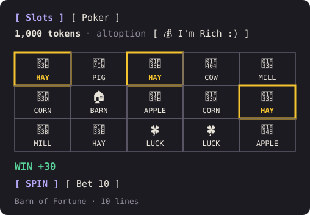
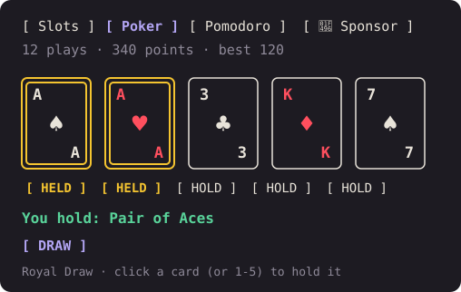

# Terminal Slots

Slots and video poker in a side pane of [Claude Code](https://code.claude.com), for something to do
while Claude works. Free tokens, a leaderboard, and nothing to buy.

An independent plugin by [altoption](https://github.com/altoption). Not made or endorsed by Anthropic.

<p>
  
  
</p>

## Install

You need Claude Code installed. In your terminal:

```
claude plugin marketplace add altoption/slots
claude plugin install terminal-slots@terminal-slots
```

Start `claude`, type `/slots`, and press **Sign in with GitHub**. To update later:
`claude plugin update terminal-slots@terminal-slots`, then restart Claude Code. What changed:
[CHANGELOG](CHANGELOG.md). Or use the one-click button on
[the website](https://terminal-slots.altoption.workers.dev).

**Install trouble?**
- *"Repository not found"*: check the spelling, `altoption/slots`.
- Don't use `sudo`: plugins install for your own user.
- *Pane not showing*: it opens on the right when the terminal is at least ~144 columns wide; `/slots`
  or the **Show** button above the prompt opens it at any width.

## Play

- **Slots**: Barn of Fortune, 5 reels × 3 rows, 10 lines. Bets 10/20/50/100.
- **Poker**: Royal Draw, Jacks or Better. Deal, then click a card (or press 1–5) to hold it, then
  DRAW. A dealt hand that already pays starts held, as on a real machine. Bets 5/10/25/50/100.
- **Tokens**: 1,000 when you sign up. **💰 I'm Rich :)** gives free tokens every 4 hours (100 to
  10,000). If you run out, a free refill (+500) is available once a day.
- A band above the prompt shows your balance, with **Show/Hide** for the pane. `/slots logout` signs out.

## Fair play: what you can check

- **The server decides every outcome.** The plugin sends your bet; the server picks the random seed
  and runs the game engine. The plugin only draws the result, so it can't be tweaked to win.
- The games run on slots-sdk, the author's slot engine (not public yet), where every spin is a
  function of its seed and can be replayed.
  - Barn of Fortune publishes a 97.48% return. 1.35 points of that come from a free-spins feature
    this plugin **doesn't run yet**, so the base game is 96.13%. Wins are paid in whole tokens,
    rounded down, which costs a little more: measured over 200,000 spins per bet size, players get
    about **94.4–96.4%** depending on the bet.
  - Royal Draw uses the 9/6 Jacks or Better paytable. Video poker's return depends on which cards
    you hold.
- **Tokens have no value.** They can't be bought, sold, transferred or cashed out, and nothing pays
  out. For entertainment only.

## What the plugin does on your machine

Everything it does, so you can check it against the code in [`plugin/hooks/`](plugin/hooks):

| What | Where | Details |
|---|---|---|
| Talks to one server | `register.tsx` `api()` | Only `https://terminal-slots.altoption.workers.dev` (fixed in the code). Sends game actions (spin, deal, draw, I'm Rich, refill), sign-in, and your session token. Nothing about your code, prompts or Claude's work. |
| Opens your browser | `signIn()`, `openMembership()` | Only GitHub's own `https://github.com/…` sign-in page, and the game site's support page. |
| Stores locally | Claude Code's plugin store | Your session token for the game server, and Claude's calibration stats. |
| Adds to Claude's system prompt | `prompt.compose` hook | One short paragraph asking Claude to record its probability that tests will pass, via a `wager` tool, before running them. |
| Watches tool calls | `tool.call` hook | Reads the text of Bash commands **locally** to spot test runs (`npm test`, `pytest`, …) and whether they passed, to score Claude's calibration (a Brier score shown in the pane). Never sent anywhere; never blocks or changes a tool call. |

### Claude's calibration

Before a test run, Claude records how likely it thinks the tests are to pass. Afterwards the pane
shows how well-calibrated it was (Brier score: 0 is perfect, 0.25 is a coin flip). No tokens are at
stake. It's a light way to see whether "this should work ✅" means anything.

## What the server stores

Your GitHub user ID and login (from sign-in), a hash of your session token (never the token itself),
and your game records: balance, a ledger of every token movement, and an open poker hand. GitHub's
own access token is used once at sign-in to learn who you are, then discarded. Your login and
balance appear on the public leaderboard.

## Support

If you enjoy it, you can chip in through GitHub Sponsors (pay what you can, from $1/month). It's a
thank-you, not a purchase: supporters get a ⭐ and gold cards; tokens stay free and the same for
everyone. The website's support page is in test mode until Sponsors is live.

## Feedback

Bug reports and ideas are welcome as [issues](https://github.com/altoption/slots/issues). Security
problems: see [SECURITY.md](SECURITY.md).

## License

All rights reserved. You're welcome to read the code, and to install and use the plugin from this
repository. Please don't redistribute it. Pull requests can't be accepted yet; open an issue instead.
